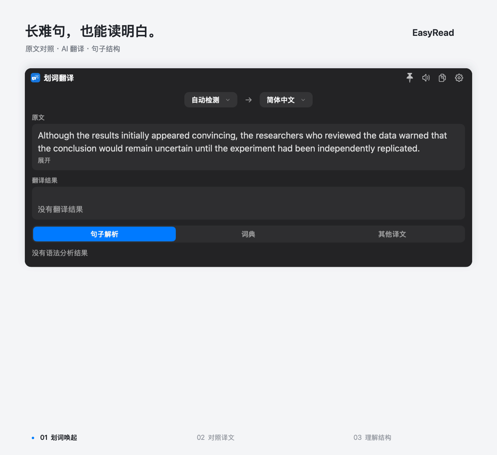

# EasyRead

[中文](README_ZH.md) · English

Select English. Understand it with AI.

An English reading assistant for macOS. Get a translation and sentence analysis
beside the text you're reading, without switching apps.



*Captured from the actual EasyRead interface: a complex sentence, its translation and grammar analysis. Waiting time is shortened.*

## Get started

[Download v0.1.1](https://github.com/RickyW0529/EasyRead/releases/tag/v0.1.1)
· macOS 13+ · Apple Silicon

1. Open **Settings → AI Translation**, configure a provider and model, test the connection, and enable AI reading.
2. Select English text, then press **Option+D** or click the selection icon.
3. Read the translation alongside the original; use sentence analysis to understand the structure.

Hovering over the selection icon does not submit a query. Shortcuts are customizable.
Grant Accessibility permission when prompted to capture selections.

AI reading is off by default. Credentials are stored in macOS Keychain; API charges
depend on your provider. Context extraction is a separate opt-in setting.
See [privacy and data flow](PRIVACY.md).

The ZIP and DMG contain the same app. This preview is development-signed and
**not notarized**; macOS Gatekeeper may block opening it.
See [release notes](docs/user-docs/en/Release-v0.1.1.md) for installation details and checksums.

## Build from source

With Xcode and CocoaPods installed:

```bash
git clone https://github.com/RickyW0529/EasyRead.git
cd EasyRead
pod install
open EasyRead.xcworkspace
```

Run the **EasyRead** scheme. See [CONTRIBUTING.md](CONTRIBUTING.md) for development
and testing, or the [local build guide](docs/user-docs/zh/Local-development-build.md)
for signing and selection permissions.

## Credits

Built on [Easydict](https://github.com/tisfeng/Easydict). Thank you to **tisfeng and
all Easydict contributors** for the selection, dictionary and translation foundation.

EasyRead remains licensed under [GPL-3.0](LICENSE), with upstream copyrights and
[third-party notices](THIRD_PARTY_NOTICES.md) retained.
