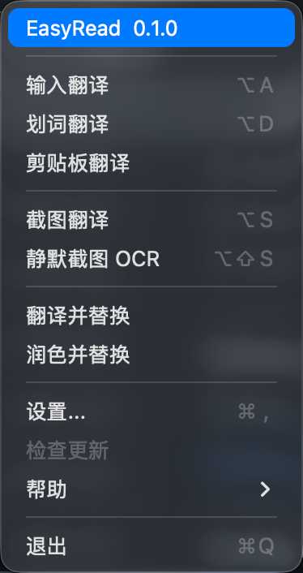

# EasyRead

[中文说明](README_ZH.md) · English

An English reading assistant for macOS. Look up words, translate passages, and
understand difficult sentences in one selection panel while you read.

## Preview and example



Select English text, then **click the selection icon** or press **Option+D** (the
default selection shortcut) to open the reading panel. Moving the pointer over the
icon does not submit a query. Shortcuts can be customized in Settings.

The **EasyRead + version** menu item opens [EasyRead releases](https://github.com/RickyW0529/EasyRead/releases).
**Help → Feedback** opens [EasyRead issues](https://github.com/RickyW0529/EasyRead/issues).
The GitHub and contributor buttons in About also open this repository.

For example, select this sentence from a technical reading session:

> The process that handles incoming requests runs in the background.

With AI reading enabled, the panel can help you compare a translation and understand
the structure. The following is an illustrative explanation; actual output varies
with the configured provider and model.

| Panel content | Example |
| --- | --- |
| Translation | 处理传入请求的进程在后台运行。 |
| Subject | **The process** — the process being described. |
| Relative clause | **that handles incoming requests** — modifies “process.” |
| Predicate | **runs** — what the process does. |
| Adverbial | **in the background** — how or where it runs. |
| Dictionary lookup | Select **process** to look up its definitions in an enabled dictionary. |

## Built on Easydict

EasyRead is developed from [Easydict](https://github.com/tisfeng/Easydict). Selection
capture, query windows, dictionary integration and translation services build on
Easydict's work. Thank you to **tisfeng and all Easydict contributors** for making
this foundation available as open source.

EasyRead focuses on reading comprehension: bringing definitions, translation and
grammar explanations together. This derivative remains licensed under
[GPL-3.0](LICENSE), with upstream copyrights and
[third-party notices](THIRD_PARTY_NOTICES.md) retained.

## Who is EasyRead for?

Mac users who can read some English but frequently get interrupted by unfamiliar
words, technical terms or long sentences:

- Students and researchers reading papers, textbooks and course material.
- Developers and professionals reading technical documentation and reference material.
- English learners who want to understand sentence structure as well as the translation.

Use a local dictionary for a quick definition; use AI assistance when you need
context or an explanation of how the sentence works.

## How to use EasyRead

### 1. Install or build the app

Download the **[v0.1.0 preview](https://github.com/RickyW0529/EasyRead/releases/tag/v0.1.0)**
for Apple Silicon Macs running macOS 13 or later. The ZIP and DMG contain the same app;
checksums are included. This preview is development-signed and **not notarized**, so
macOS Gatekeeper may block opening it. See the [release notes](docs/user-docs/en/Release-v0.1.0.md).

To build from source, you need full Xcode, the macOS SDK and CocoaPods:

```bash
git clone https://github.com/RickyW0529/EasyRead.git
cd EasyRead
pod install
open EasyRead.xcworkspace
```

Select the **EasyRead** scheme in Xcode and run it. For local signing, a stable
installation path and selection permissions, see the
[local development guide](docs/user-docs/zh/Local-development-build.md).

### 2. Configure dictionary lookup

Open the macOS **Dictionary** app, enable the dictionaries you need in its settings,
and wait for the downloads to finish. Enable **Apple Dictionary** in EasyRead's
service settings. Local dictionary lookup then works without an AI key or a network
connection.

Grant Accessibility permission when prompted to capture selections, or enter text
manually in the query window. Selection support depends on the source application's
accessibility APIs.

### 3. Enable AI assistance when needed

Open **Settings → AI Translation**, choose a provider, enter your API key if required,
and select a model. Use **Test connection**, then enable AI reading. You can also
configure a custom API endpoint and model identifier. Credentials are stored in
macOS Keychain; API availability and charges depend on the selected service.

AI is off by default. Once enabled, submitting a supported query can automatically
generate reading assistance. Context extraction is a separate opt-in setting under
Privacy; limited surrounding text may also be sent when it is enabled and available.
See [privacy and data flow](PRIVACY.md).

### 4. Read the selection panel

Select text in a supported application and invoke EasyRead using your configured
selection action or shortcut:

- **Original / translation:** compare both texts; use speak and copy beside the translation heading.
- **Sentence analysis:** read underlined fragments with grammar labels directly below them,
  alongside explanations when space permits.
- **Dictionary:** read Apple Dictionary and other enabled dictionary results.
- **Other translations:** compare results from other enabled services.

The query window follows the content and available screen space. Expand or scroll
long content; narrow windows stack the analysis vertically. AI failures do not
prevent an independent local dictionary lookup.

## Why use AI-assisted translation?

A translation tells you what a passage means. Reading also requires understanding
why it means that. AI assistance can help connect the two:

- **Contextual meaning:** distinguish a technical use of *process* in an operating-systems
  text from its other everyday meanings.
- **Sentence structure:** identify subjects, predicates, modifiers and inserted clauses,
  and relate each explanation to the original fragment.
- **Learning through comparison:** keep the original, translation and explanation together
  so you can return to the English after reading the explanation.

Local dictionaries remain useful for quick, offline definitions. AI adds explanation
when a definition alone is not enough. It can still make mistakes, so check the
original wording when an interpretation matters.

## Development

Application code is in `EasyRead/`, app tests in `EasyReadTests/`, and independently
testable context and privacy logic in `EasyReadKit/`.

```bash
swift test --package-path EasyReadKit
```

See [CONTRIBUTING.md](CONTRIBUTING.md) for build and contribution instructions.
